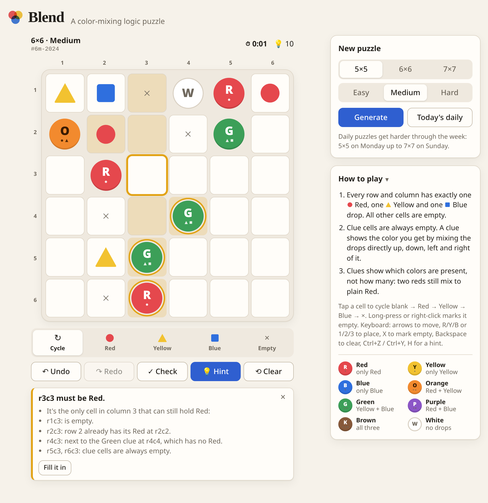

# Blend

**A color-mixing logic puzzle.** Minesweeper meets Queens, but the clues are paint colors.

### ▶ [Play it in your browser](https://jumf2222.github.io/blend/)

Free, no sign-up, works on phones and desktops. A new daily puzzle every day.



## How to play

Fill the grid with paint drops so that:

1. **Every row and every column has exactly one 🔴 Red, one 🟡 Yellow and one 🔵 Blue drop.** All other cells are empty.
2. **Clue cells are always empty.** Each clue shows the color you get by mixing the drops directly up, down, left and right of it.
3. **Clues show which colors are there, not how many.** Two Reds next to a clue still mix to plain Red.

| Clue | Its neighbors contain… |
|---|---|
| 🟥 Red, 🟨 Yellow, 🟦 Blue | only that color |
| 🟧 Orange | Red and Yellow, no Blue |
| 🟩 Green | Yellow and Blue, no Red |
| 🟪 Purple | Red and Blue, no Yellow |
| 🟫 Brown | all three colors |
| ⬜ White | no drops at all |

Every clue does two jobs: it tells you which colors must be nearby, and it **rules out** every other color from all of its neighbors.

### Example

```
     1  2  3  4  5
1    ·  ·  ·  ·  O
2    R  ·  ·  ·  ·
3    ·  G  ·  ·  ·
4    ·  ·  ·  ·  ·
5    ·  ·  ·  ·  ·
```

A good first move: the cell in row 2, column 2 touches the **R** clue (so it can't be Yellow or Blue) and the **G** clue (so it can't be Red). It must be empty.

<details>
<summary>Show the solution</summary>

```
R B · Y ·
· · Y B R
· · B R Y
B Y R · ·
Y R · · B
```

</details>

### Controls

- **Tap** a cell to cycle: blank → Red → Yellow → Blue → × (marked empty).
- **Long-press** (touch) or **right-click** to mark a cell empty.
- Or pick a color in the toolbar and tap to place it directly.
- **Keyboard:** arrow keys to move, `R` `Y` `B` (or `1` `2` `3`) to place, `X` to mark empty, `Backspace` to clear, `Ctrl+Z` / `Ctrl+Y` to undo/redo, `H` for a hint.

## Features

- **Every puzzle has exactly one solution and never needs guessing.** Each one is checked to be solvable by logic alone.
- **Hints that teach.** A hint doesn't just reveal a cell. It explains *why*, step by step.
- **Live mistake highlighting** for repeated colors in a row or column, and for clues that no longer fit.
- **Daily puzzle** that gets harder through the week, from 5×5 on Monday to 7×7 on Sunday, with a streak counter.
- **Three sizes (5×5, 6×6, 7×7) and three difficulties.**
- **Shareable links and results.** The address of each puzzle opens that exact puzzle (for example [`#6m-2024`](https://jumf2222.github.io/blend/#6m-2024)), and you can copy an emoji summary when you finish.
- **Colorblind-friendly:** drops differ by shape (● Red, ▲ Yellow, ■ Blue) and clues show a letter.
- **Light and dark mode**, and your progress is saved in your browser.

## How the puzzles are made

1. Pick a random valid solution.
2. Put a clue on every empty cell.
3. Remove clues one at a time, keeping a removal only if the puzzle can still be solved by a set of human-style deduction rules. Then an exhaustive search confirms there's exactly one solution.
4. Harder puzzles keep fewer clues. Easier ones get a few of the removed clues back.

The deduction rules are the same ones the hints use:

- A clue removes every color it doesn't contain from all of its neighbors.
- Once a color is placed in a row or column, no other cell in that line can have it. If a color fits in only one cell of a line, it goes there.
- Each line has exactly *N* − 3 empty cells, so once those are known the rest hold drops (and the other way around).
- If only one neighbor of a clue can hold one of the clue's colors, that color goes there.

## Development

Built with [SolidJS 2](https://www.solidjs.com/) and [Vite](https://vite.dev/). Requires Node.js 22.12 or newer.

```sh
npm install
npm run dev      # start a local server at http://localhost:5173
npm test         # run the puzzle-engine and UI tests
npm run build    # type-check and build the site into dist/
```

Every push to `main` is tested, built and deployed to GitHub Pages by [`.github/workflows/pages.yml`](.github/workflows/pages.yml).

### Project layout

| Path | What's there |
|---|---|
| `src/engine/` | The puzzle engine (no UI code): generator, deduction rules with hint explanations, solution checker, mistake detection |
| `src/game.ts` | Game state: moves, undo/redo, timer, hints, saving progress |
| `src/components/` | The board, toolbar, side panels and win screen |
| `prototype/` | The original Python prototype of the generator (`python gen.py <seed>`) |

### Ideas for later

- Variant rules: "bold" clues that also count how many drops touch them, or diagonal neighbors that count toward the mix.
- A two-player mode where players take turns revealing clues.

Contributions and puzzle-design ideas are welcome. Feel free to open an issue or pull request.

## License

[MIT](LICENSE)
